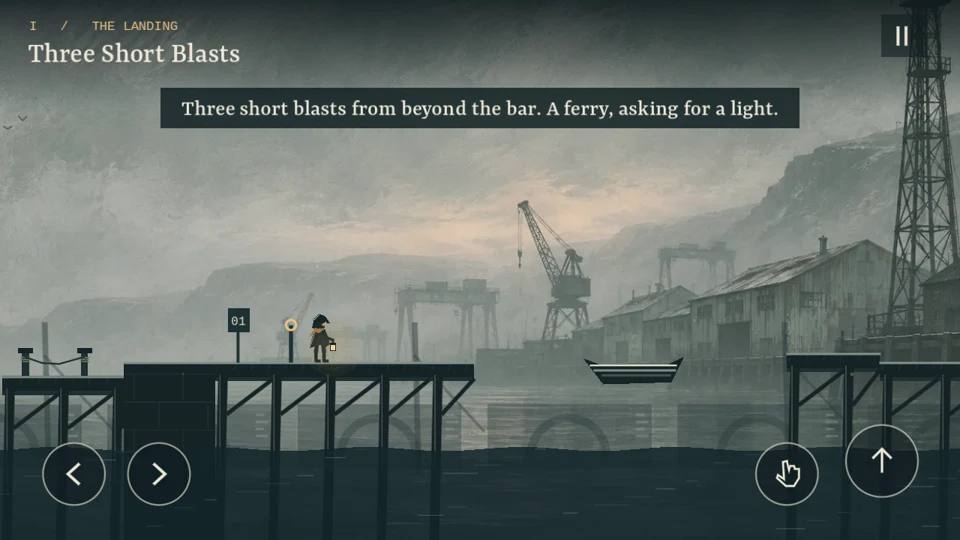
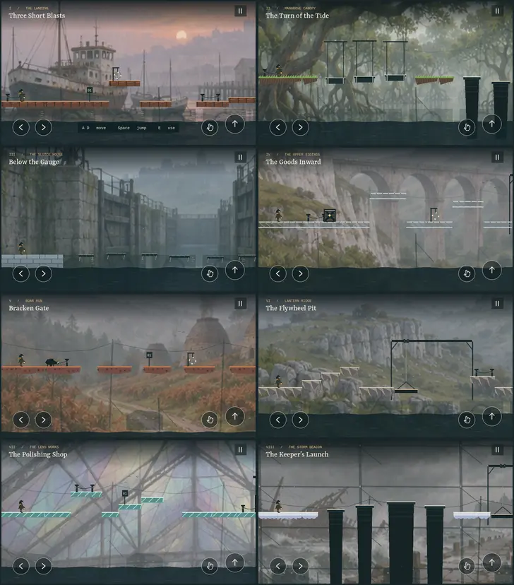
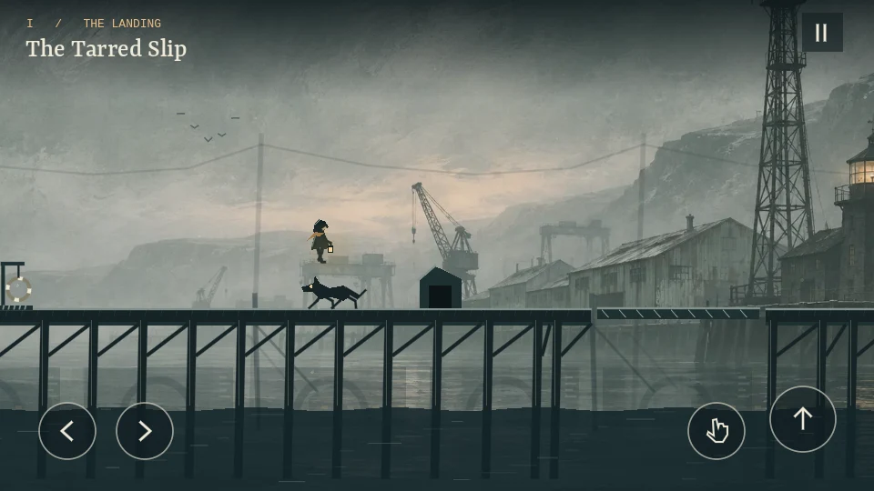

# The Last Ferry

A single-player, offline Android puzzle adventure. Three horn blasts reach a flooded harbor. As the ferry keeper, cross the station, restore its machinery, and bring the waiting ship home.



## Play version 1.6.7

Install `dist/the-last-ferry.apk` on an OpenGL ES 3-capable device running Android 7.0 or later. The APK includes ARM64, ARMv7, and x86-64 builds. On a connected device you can install it with `adb install -r dist/the-last-ferry.apk`. Open **The Last Ferry** and choose **New game** or **Continue**. The local 1.6.7 APK upgrades earlier local builds. Retained locations keep their checkpoint lamps. Saves in a retired location resume at the entrance to the next retained location. A version 1 save resumes at the corresponding harbor landmark.

| Action | Touch | Keyboard |
| --- | --- | --- |
| Move | Left and right arrows | A / D or arrow keys |
| Jump or catch a ledge | Up arrow while moving toward the lip | Space, W, or Up while moving toward the lip |
| Pull up or drop | Keep holding toward the ledge or tap jump to climb. Move away to let go. | Same with movement and jump keys |
| Operate nearby machinery | Hand | E or Enter |
| Move a crate | Hold the hand while moving | Hold E while moving |
| Work a station | Tap the diagram | Arrows and Space or Enter |
| Undo, reset, hint | Station buttons | Z, R, H |
| Pause or close an instrument | Pause or Android Back | Esc |

During play, press **R** or tap the gold **R** button to skip directly to the next scene for debugging. The main voyage checkpoint is kept when you skip. Set `ferry/testing/scene_skip` to false in Project Settings to hide the button and disable the shortcut.

The game saves at crossing entrances and checkpoint lamps. **Continue** returns to the latest safe ground. Chapter replay and the **Puzzle workshop** have their own play state. Settings lets you mute the game and resize the movement, jump, and hand buttons from 75% to 150%.

## Campaign

The keeper crosses **94 named locations across 21 chapters, with two to five locations per chapter**. All chapters are open in the chapter picker for debugging, including on a fresh installation. Chapter replay keeps the main voyage checkpoint and earned unlocks separate. The first chart appears at the landing. After solving a required panel, you get seven minutes of active traversal before another checkpoint can offer a puzzle. Unoccupied stations light as you walk past. Pausing, using an instrument, and browsing menus leave the interval frozen.

The same boar carries the keeper through all twelve mounted scenes. In Boar Run, jump breakable plank groups and spillways and watch for spiders. The lamps save progress as you pass and the next eligible puzzle appears off the boar road. Ledge grabs work on foot and are disabled while riding a boar or trolley.

Seven locations have a two-chamber lock. Fill chamber I from the bank, board the first pontoon, then tap the hand to transfer the water. Jump to chamber II as the first float sinks and the second rises. Tilting bridges have a jump at each end and pull the keeper downhill as they tip. The brass-edged causeways have wider gaps than the standard causeways. Elsewhere, the route crosses spillways, high aqueducts, and counterweight lifts. Skiffs cross faster. Falling into water plays a quieter splash, while contact hazards play a separate impact sound. The opening quay has four rotten planks. The Broken Jetty has seven. Tidal crossings range from one moving deck to five.

The eight puzzle categories rotate in order. Plot a course through buoys, switch a relay grid, balance the bell, route a mirror beam, push freight, join pressure pipes, clear a skiff channel, and meter sluice water. The workshop opens all eight from the title screen. Use **Next layout** to browse all 66 boards at any time.



The harbor hound barks before charging and turns at the yard posts. Jump its first pass, then watch behind you for the return sprint. Crates can be pushed or pulled while holding the hand button. The keeper faces the crate in both directions. Overhead hoists run on fixed rails, and vertical lift cages travel between guides with a counterweight.

Two short original music cues accompany the hounds and steam. To replace them in your own build, use non-looping Ogg Vorbis files at `game/audio/pursuit.ogg` and `game/audio/undertow.ogg`, then rebuild.



The campaign includes over an hour of tested traversal. First-time human completion times can vary. [Playtest and package checks](docs/playtest.md)

## Build on Linux

Use a JDK with `javac` and `keytool` (17 or later), Bash, curl, unzip, and the standard checksum utilities. Run these commands from this directory.

```bash
bash scripts/setup-android.sh
bash scripts/check.sh
bash scripts/build-android.sh
```

Setup reuses Godot 4.7.2 and its matching export templates if available. Missing Linux x86-64 tools come from the official Godot and Android distributions, with pinned archive checksums. Project downloads, caches, editor settings, test saves, and scratch files live under `.work/` on this drive. Imported game resources live in `game/.godot/`. The signed, release-template APK and its SHA-256 checksum go in `dist/`.

For desktop play or editing, use the project environment in the same shell.

```bash
source scripts/env.sh
godot --path game
# Open the editor
godot --editor --path game
```

The default sideload signing key is generated locally in `.work/android-user/`. Keep it to install updates over an existing copy. To use a separate key, set `GODOT_ANDROID_KEYSTORE_RELEASE_PATH`, `GODOT_ANDROID_KEYSTORE_RELEASE_USER`, and `GODOT_ANDROID_KEYSTORE_RELEASE_PASSWORD` before building. All three stay outside source control.

## GitHub Actions

The **Android APK** workflow runs on pushes or from **Actions → Android APK → Run workflow**. It installs the pinned tools, exports and verifies the APK, runs the campaign checks, and uploads **the-last-ferry-android**. Download and extract that artifact to get the APK. Each clean runner generates a fresh sideload signing key, so installing across differently signed builds can require uninstalling the previous copy and losing its local save.

## Source and materials

The editable project is in `game/`. `campaign.gd` and `crossings.gd` define the landmarks and passages. The puzzle layouts are in `game/art/schematics.json` and `campaign.gd`. The art, sound, icon, and data assets ship with the project and work offline.

`scripts/author_boards.py` reproduces and solves the original five families of station layouts. `scripts/compose.py` synthesizes the ambience and machinery sounds. `scripts/compose_accents.py` synthesizes the encounter music. The audio tools use NumPy, SciPy, and FFmpeg. `scripts/make_icon.py` draws the beacon mark with Pillow. These tools are optional for an ordinary build.

The dog warning uses a trimmed recording by Amada44, distributed under CC BY-SA 3.0. The attribution and license are available in the game. [Original recording](https://commons.wikimedia.org/wiki/File:Barking_of_a_dog.ogg)

Harbor paintings were created for this game with OpenAI ImageGen. Godot, Yrsa, Liberation Mono, and their license notices are credited in **Credits → Licenses**.
